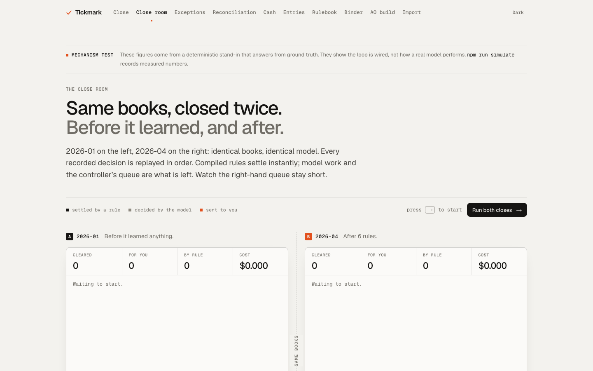
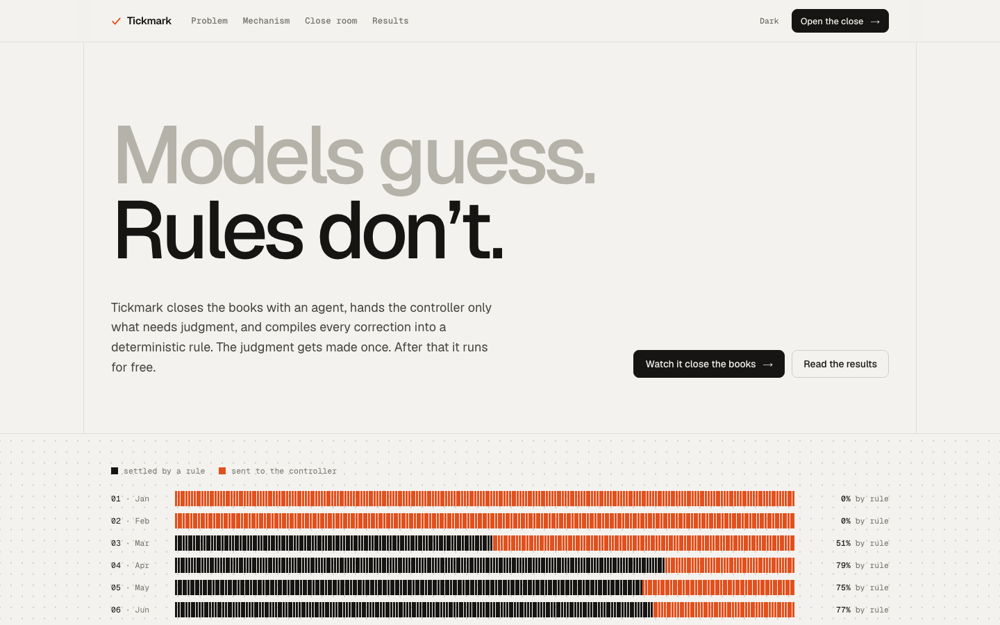
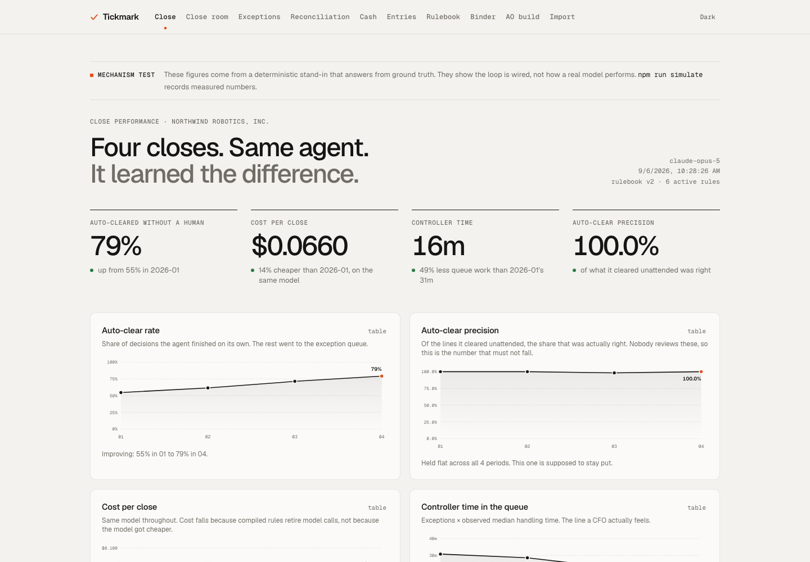
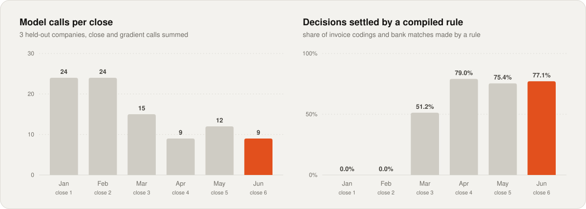
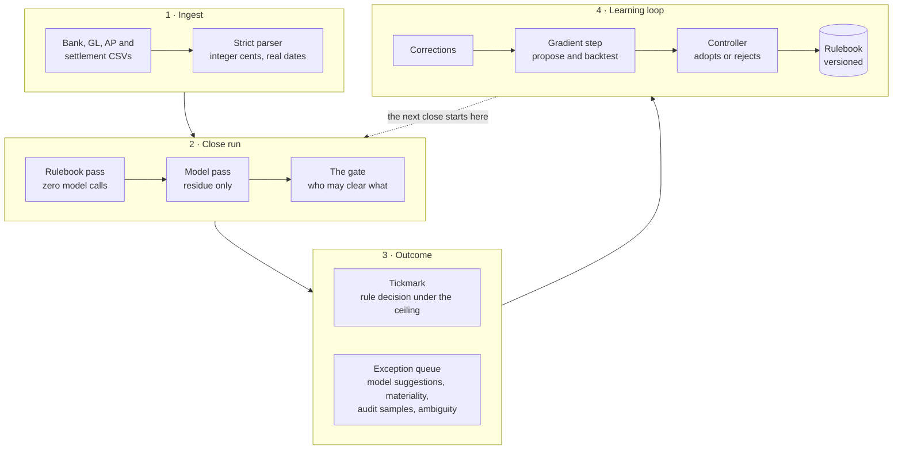

<h1 align="center">Tickmark</h1>

<p align="center"><b>The month-end close that gets cheaper every month.</b></p>

<p align="center">
An agent that codes the AP ledger and reconciles the bank, hands a controller only what needs
judgment, and compiles every correction into a deterministic rule. The judgment gets made once,
and then it runs for free.
</p>

<p align="center">
<a href="https://github.com/taranggoyal70/tickmark/actions/workflows/ci.yml"></a>
<a href="#verify-a-checkout"></a>
<a href="#measured-results"></a>
<a href="LICENSE"></a>
<a href="https://tickmark-kappa.vercel.app"></a>
</p>

<p align="center">
Winner, <b>Track 2: Autonomous Office of the CFO</b>, Syndicate by Maximor 2026
</p>

<p align="center">
<a href="#measured-results">Measured results</a> ·
<a href="#how-it-works">How it works</a> ·
<a href="#quick-start">Quick start</a> ·
<a href="#configuration">Configuration</a> ·
<a href="#status-and-limits">Status and limits</a>
</p>

<picture>
  <source media="(max-width: 600px) and (prefers-color-scheme: dark)" srcset="docs/readme/hero-narrow-dark.svg">
  <source media="(max-width: 600px)" srcset="docs/readme/hero-narrow.svg">
  <source media="(prefers-color-scheme: dark)" srcset="docs/readme/hero-dark.svg">
  
</picture>

> A **tickmark** is the small symbol an accountant puts beside a ledger line to say *"I checked
> this, and here is how."* Auditors have used them for a century. This product issues tickmarks,
> and earns the right to issue them without asking.

## Why it exists

Month-end close is five to ten days of a controller repeating last month's judgments: tying the
bank statement to the general ledger, deciding which GL account and department each vendor invoice
hits, and finding costs that were incurred but never invoiced. The judgment is real, and it is also
repetitive: the same vendor, the same split, the same odd settlement pattern, every month.

Most agents "learn" by growing a prompt, so every lesson makes the next call longer and none of it
can be audited. Tickmark compiles learning into **rules**: a predicate and an action, versioned,
readable, backtested against closed months and executed with **zero model calls**. More learning
means fewer calls, not bigger ones.

## What it takes over

The track lists six workflows. Tickmark does all six on ingested books.

| Workflow | What it does |
|---|---|
| **Closing the books**<br>`npm run close` · dashboard | Applies the entity's earned rulebook first, sends only the residue to the model, and writes tickmarks with their evidence. A provider outage does not stop the close. |
| **Reconciling accounts**<br>`/close/reconciliation` | Handles one-to-one, batch, instalment and lockbox matches, names every residual (`fx`, `bank_fee`, `partial`, `timing`) and lists each unreconciled line at its amount. |
| **Processing invoices**<br>AP coding · `/close/exceptions` | Codes GL account and department split per invoice. Anything not settled by a backtested rule goes to the queue with the reason it stopped. |
| **Gathering audit support**<br>`/close/binder` · JSON / CSV | Assembles every tickmark, match and correction for a period into a binder an auditor can download (requires sign-in). |
| **Preparing cash reports**<br>`/close/cash` | Reads actuals from the bank statement, not the ledger, because the bank is the source of truth for cash. |
| **Updating forecasts**<br>`/close/cash` | Projects the next period with each line's basis and the number of periods behind it; a vendor seen once is labelled thin evidence, not averaged in. |

## The app

<picture>
  <source media="(prefers-color-scheme: dark)" srcset="docs/readme/screens/close-room-dark.png">
  
</picture>

<table>
<tr>
<td width="50%"><picture><source media="(prefers-color-scheme: dark)" srcset="docs/readme/screens/home-dark.png"></picture></td>
<td width="50%"><picture><source media="(prefers-color-scheme: dark)" srcset="docs/readme/screens/close-dark.png"></picture></td>
</tr>
</table>

Every screen ships light and dark, and runs read-only without sign-in or a database: the close
room, the results and the rulebook work on the bundled sample company.

## Measured results

`npm run eval` closes **six consecutive months** for each of seven synthetic companies and scores
every decision against an answer key the agent never sees. After each close a simulated controller
works the exception queue from that answer key, the gradient step compiles the corrections into
proposed rules, and a rule is adopted only if its replay clears the bar (at least 2 corrections as
evidence, at least 2 replayed firings, precision of at least 0.95). Nothing reviews what the agent
cleared unattended; those lines are scored against the answer key instead.

**Headline: held-out round 2**, three companies (seeds 404, 505, 606) summed per close:

| Close | Model calls | Est. cost at Opus 5 list | Invoices coded right | Bank matches right | Settled by a rule | Cleared unattended (wrong) | To the queue |
|---|---:|---:|---:|---:|---:|---:|---:|
| 1 · Jan | 24 | $0.4273 | 1 / 86 | 118 / 148 | 0 / 234 | 0 (0) | 248 |
| 2 · Feb | 24 | $0.4582 | 86 / 92 | 122 / 152 | 0 / 244 | 0 (0) | 257 |
| 3 · Mar | 15 | $0.2134 | 86 / 86 | 153 / 154 | 123 / 240 | 123 (0) | 123 |
| 4 · Apr | 9 | $0.0939 | 88 / 88 | 143 / 146 | 185 / 234 | 185 (0) | 58 |
| 5 · May | 12 | $0.1212 | 90 / 90 | 157 / 158 | 187 / 248 | 187 (0) | 67 |
| 6 · Jun | 9 | $0.1009 | 86 / 86 | 147 / 150 | 182 / 236 | 182 (0) | 60 |

From the first close to the sixth, model calls fell from 24 to 9 and estimated cost from $0.4273 to
$0.1009, while **0 of the 677 lines cleared without review were wrong**. In close 6, all 86
invoices and 96 of 150 statement matches were settled by a compiled rule. No adopted rule was
contradicted by a later human correction at any company. Held-out round 1 (seeds 101, 202, 303)
also ends with 0 wrong after the fix described below.

<picture>
  <source media="(prefers-color-scheme: dark)" srcset="docs/readme/results-dark.svg">
  
</picture>

### When a vendor changes its policy

A rule that was right can become wrong. In the drift scenario, held-out company 101's Digi-Key
invoices move to a different account and department from April. The same eval runs twice, once
with no audit sampling and once with 25% of rule decisions drawn for review:

| Digi-Key invoices | Apr | May | Jun | Wrong and unreviewed |
|---|---|---|---|---:|
| No audit sampling | 4 by rule, 4 wrong | 3 by rule, 3 wrong | 2 by rule, 2 wrong | **9** |
| 25% audit sampling | 4 by rule, 3 wrong, 1 audited | rule suspended, 3 reviewed | relearned, 2 by rule, 0 wrong | **3** |

The audited April invoice contradicts the active rule, so the rule is suspended before the gradient
step runs, May goes to people, and June is settled by the relearned rule. The cost is review time:
across six closes, 177 lines cleared unattended with sampling against 226 without.

<details>
<summary><b>Methodology and caveats</b></summary>

- **Synthetic books.** Every company comes from the same generator (`src/lib/seed/generate.ts`):
  bank aliases that never match the legal name, processor payouts net of fees, EUR invoices settling
  at a different rate than they accrued, freight paid in two tranches, a vendor that goes silent so
  accrual completeness has something to catch. The dev company (Northwind, seed 0) is
  byte-for-byte pinned by a test.
- **Held out.** A held-out company re-draws amounts and dates from its seed and re-draws each
  vendor's GL account and department split (`eval/companies.ts`), so a rule learned at Northwind
  is wrong there. Payroll, the processor, an annual prepaid and the contractor platform keep their
  accounts because the ledger structure depends on them. The held-out companies share the
  generator, so this tests that learning transfers to unseen policies, not to an unseen data
  distribution.
- **Two rounds, each run once.** Round 1 (seeds 101, 202, 303) was fixed in advance and run once.
  It found a defect: same-day settlement matching swept an unrelated wire fee or chargeback into
  a payroll match (1 wrong unattended clear at seed 202, 3 at seed 303). That was fixed in
  `c448b8c`, round 1 now ends at 0 wrong, and because round 1 informed the fix it no longer counts
  as clean evidence. Round 2 (seeds 404, 505, 606) was chosen after the fix and run once. It is the
  headline.
- **Offline baseline, not a model.** The committed numbers use `eval/baseline-model.ts`, a
  deterministic stand-in that answers only from what the prompt shows it (the vendor's coded
  history, the open ledger lines). Token counts are estimates (characters / 4) priced at the
  Claude Opus 5 list price ($5 / $25 per million tokens, `src/lib/agent/pricing.ts`). The stand-in
  exists so CI can reproduce every number: `npm run eval -- --check` fails if one changes.
- **What does and does not depend on the model.** Every fresh model suggestion goes to review
  regardless of its confidence, so rule learning, the fall in calls, what clears unattended and its
  precision do not depend on model quality. Model quality changes how good the suggestions in the
  queue are and how many output tokens they cost.
- **Model calls** per close are coding batches (20 invoices each), matching batches (12 lines each)
  and one gradient call per company. Costs are truncated to four decimals and shares to one; no
  number here is rounded up.
- **Contradictions** are counted for active coding rules: a later correction on an invoice the
  rule would have coded differently. Matching rules are not yet checked this way.

</details>

### With a real model

`npm run eval:model` runs the same companies through whatever model `.env.local` configures and
writes `eval/results/model-<id>.json` with the provider's own token counts. Two runs are committed,
both over held-out round 2: a frontier model through a paid API, and a 3B model on a laptop.

**`gpt-6.2-sol`, through the OpenAI API.** Cost is the provider's token counts priced at $2 per
million input and $10 per million output tokens, for the three companies together:

| Close | Model calls | Tokens in / out | Cost | Invoices coded right | Bank matches right | Settled by a rule | Cleared unattended (wrong) | Failed batches |
|---|---:|---:|---:|---:|---:|---:|---:|---:|
| 1 · Jan | 24 | 61,891 / 30,783 | $0.432 | 2 / 86 | 140 / 148 | 0 / 234 | 0 (0) | 0 |
| 2 · Feb | 24 | 66,224 / 31,473 | $0.447 | 89 / 92 | 146 / 152 | 0 / 244 | 0 (0) | 0 |
| 3 · Mar | 15 | 29,376 / 12,009 | $0.179 | 86 / 86 | 154 / 154 | 123 / 240 | 123 (0) | 0 |
| 4 · Apr | 9 | 13,651 / 4,768 | $0.075 | 88 / 88 | 146 / 146 | 185 / 234 | 185 (0) | 0 |
| 5 · May | 12 | 18,119 / 5,959 | $0.096 | 90 / 90 | 158 / 158 | 187 / 248 | 187 (0) | 0 |
| 6 · Jun | 9 | 14,304 / 5,120 | $0.080 | 86 / 86 | 150 / 150 | 182 / 236 | 182 (0) | 0 |

**0 of 677 unattended clears were wrong.** Model calls fell from 24 to 9, tokens per close from
92,674 to 19,424 and cost per close from $0.432 to $0.080. The first close has no vendor history to
go on, so even this model coded 2 of 86 invoices to the company's own accounts; with one close of
history it coded 89 of 92, and every invoice after that. It cleared exactly as many lines as the
offline stand-in, because only a rule clears unattended and both runs compiled the same rules from
the same corrections. What the stronger model changes is the queue: the controller confirms right
suggestions instead of fixing wrong ones, and no batch failed. The bundled dev company shows the
same shape (calls 8, 8, 5, 3, 4, 3; 0 wrong), and the whole run, dev company included, cost $1.72.

**`llama3.2:latest` (3B, Q4, through Ollama), on a laptop:**

| Close | Model calls | Tokens in / out | Invoices coded right | Bank matches right | Settled by a rule | Cleared unattended (wrong) | Failed batches |
|---|---:|---:|---:|---:|---:|---:|---:|
| 1 · Jan | 23 | 46,838 / 32,205 | 0 / 86 | 0 / 148 | 0 / 234 | 0 (0) | 1 |
| 2 · Feb | 18 | 43,712 / 20,377 | 12 / 92 | 0 / 152 | 0 / 244 | 0 (0) | 4 |
| 3 · Mar | 12 | 24,313 / 8,917 | 53 / 86 | 68 / 154 | 121 / 240 | 121 (0) | 1 |
| 4 · Apr | 9 | 12,060 / 6,298 | 88 / 88 | 105 / 146 | 184 / 234 | 184 (0) | 0 |
| 5 · May | 11 | 14,899 / 4,310 | 87 / 90 | 98 / 158 | 185 / 248 | 185 (0) | 1 |
| 6 · Jun | 9 | 13,443 / 2,214 | 86 / 86 | 95 / 150 | 181 / 236 | 181 (0) | 0 |

This model is poor at the work: in the first two closes it coded 12 of 178 invoices correctly and
matched no bank lines, and 7 of its batches failed and went to the queue as `model_unavailable`.
It made no difference to what cleared unattended, because a model suggestion never clears: **0 of
671 unattended clears were wrong**, every one of them settled by a rule compiled from corrections.
Model calls fell from 23 to 9 and tokens per close from 79,043 to 15,657. The bundled dev company
shows the same shape (calls 8, 4, 5, 2, 3, 3; 0 wrong). The run is local, so no dollar cost is
reported for it.

Earlier real-model evidence, from a four-period run on `llama3.2:1b`, is in
[docs/MEASURED-EVIDENCE-2026-09-06.md](docs/MEASURED-EVIDENCE-2026-09-06.md).

## How it works



1. **Ingest.** Every book, including the bundled sample, enters through the same CSV path. Headers
   are matched by alias; money becomes integer cents; a row that cannot be read is reported with
   its table, line and reason rather than dropped.
2. **Rulebook pass.** Active rules code invoices and match bank lines deterministically. A
   matching rule that finds two equally good candidates refuses rather than guesses.
3. **Model pass.** Only what no rule settled goes to the model, batched, with TOON-encoded
   context. If the provider is down, the remainder goes to the queue as `model_unavailable`.
4. **The gate.** A fresh model suggestion always goes to review as `unverified_model_judgment`,
   however confident. A rule decision clears only under the entity's rule ceiling, and anything over
   materiality needs a person (the sample company sets $250,000 and $25,000). A deterministic fraction of rule decisions can be drawn
   for audit.
5. **Learning.** A correction is the loss signal. The gradient step distils corrections into
   proposed rules, replays each over every closed period, and only a rule with the evidence and
   precision to pass can be adopted, by a named approver. A rule contradicted by a later correction
   is suspended.

### Guardrails in the schema

These live in the database (`supabase/migrations/`), not in a prompt, and `npm run verify:db`
proves each by violating it and requiring the database to refuse:

1. **Debits equal credits**, checked arithmetically by a trigger, never taken from model output.
2. **Tickmarks are append-only.** A trigger rejects every `UPDATE` and `DELETE`; you supersede a
   tickmark, you never edit one.
3. **Materiality is a hard gate.** Nothing above it auto-posts, whatever the confidence.
4. **Preparer is not approver**, as a constraint rather than a convention.
5. **No rule activates without a backtest** and evidence from at least two corrections.
6. **Every decision traces** to a rule and its corrections, or a close run and its evidence.

```
PASS  unbalanced journal entry is refused            debits 100 <> credits 0
PASS  preparer == approver is refused                segregation of duties
PASS  updating a tickmark is refused                 tickmarks are append-only
PASS  deleting a tickmark is refused                 tickmarks are append-only
PASS  activating an unbacktested rule is refused     invariant 6
PASS  activating a rule with 1 correction is refused evidence gate
```

### The human gate, in practice

1. The queue shows only what the agent **declined to assert**, each with the proposal, the
   confidence, and why it stopped.
2. Resolving one writes a **correction**: structured, attributable, persisted.
3. Ticking **"always do this"** does not make a rule. The first ask records a **standing intent**
   and says so: one correction is an anecdote.
4. The second agreeing correction proposes a **rule**, citing both verbatim, with a backtest
   already replayed against every closed period.
5. The controller adopts or rejects. A database trigger refuses an anonymous activation, and a rule
   whose evidence all came from its own adopter is marked **self-evidenced** for good.
6. **A proposal that failed the replay cannot be adopted.** The queue says so instead of offering
   the button.
7. **Equivalent proposals stay evidence, not extra behaviour.** A canonical signature over kind,
   predicate and action allows one active rule per entity.

`npm run verify:gate` runs that sequence against a live database and restores the queue afterwards.

### Engineering decisions

| Constraint | Approach | Tradeoff |
|---|---|---|
| Learning has to be auditable | Compile corrections into predicate and action rules, not prompt text | A rule covers only what its predicate names; a new vendor still needs the model and a person |
| Unattended work must not be wrong | Only backtested rules clear, under a ceiling; model suggestions always go to review | The first two closes clear nothing unattended |
| Money must be exact | Integer cents, debit-positive; the parser refuses a third non-zero decimal and an impossible date | Sub-cent FX precision is not represented; the difference is named as an `fx` residual |
| A rule must not guess | When two candidates fit, take the single exact tie-out or refuse | More exceptions where invoices for one vendor have similar amounts |
| Vendors change policy | Deterministic audit sampling plus suspension of contradicted rules | Sampling spends review time (177 vs 226 unattended clears in the drift scenario) |
| Results must be reproducible | Seeded generator, offline stand-in model, committed results, CI `--check` | The headline measures the mechanism, not a model's skill |
| A provider outage must not stop a close | Rules settle what they can; the rest is labelled `model_unavailable` | The close does less, visibly, instead of failing |
| Authorization must not drift from routing | Check auth next to the data (server actions, the queue layout, the binder route) rather than by path matching | Each new write path has to remember to check |
| The product must run without provisioning | Persistence behind one seam: Supabase when configured, `data/` otherwise | Database-only guarantees (triggers) are verified only when Supabase is present |

### Technology

| Layer | Choice |
|---|---|
| App | Next.js 16 App Router, React 19, Tailwind 4 |
| Model access | AI SDK 7: any OpenAI-compatible endpoint, the Anthropic API, or the Vercel AI Gateway (default `anthropic/claude-opus-5`) |
| Context encoding | TOON, following the [AXI](https://github.com/kunchenguid/axi) principles |
| Data | Supabase Postgres, with invariants as triggers; filesystem fallback in `data/` |
| Auth | Clerk 7 |
| Validation | zod 4 at every boundary |
| Tests | `node:test` through tsx; offline eval as a regression gate |
| Design | Tokens from [awesome-design-md](https://github.com/VoltAgent/awesome-design-md) `stripe`; chart colours checked for colour-vision deficiency |

The evidence gate and "analysis never writes" are borrowed, with credit, from
[backpass](https://github.com/kunchenguid/backpass).

## Quick start

Requires Node 22.18 or later (`.nvmrc` pins 24).

```bash
git clone https://github.com/taranggoyal70/tickmark && cd tickmark
npm ci
npm test
npm run eval -- --check
```

```
ℹ tests 74
ℹ pass 74
ℹ fail 0
eval: 9 runs reproduce eval/results/offline.json exactly
```

`npm run eval` prints a per-close table for every company, for example:

```
Held-out company, seed 404
close  rules  calls  coding  by-rule  match  by-rule  cleared  wrong  exc  contra
    1      0      8    0.0%     0.0%  78.4%     0.0%        0      0   83       0
    2      0      8   93.5%     0.0%  77.3%     0.0%        0      0   87       0
    3     13      5  100.0%    64.5%  98.1%    49.0%       46      0   40       0
    4     34      3  100.0%   100.0%  94.6%    60.7%       67      0   25       0
    5     37      4  100.0%    96.2%  98.0%    60.0%       56      0   23       0
    6     37      3  100.0%   100.0%  94.2%    61.5%       63      0   22       0
```

### Run modes

| Command | Needs | What it does |
|---|---|---|
| `npm run eval` | nothing | Six closes at seven synthetic companies with the offline stand-in; writes `eval/results/offline.json` |
| `npm run eval:model` | a model | The same eval through a real model; writes `eval/results/model-<id>.json` |
| `npm run selftest` | nothing | The whole loop (close, gate, queue, corrections, gradient, backtest, rulebook) with a stand-in |
| `npm run simulate` | a model | The bundled sample company with a real model; the dashboard renders its report |
| `npm run ingest` / `npm run close` | Supabase | Import your own books, then close a period with the rulebook that entity has earned |
| `npm run dev` | Clerk | The dashboard on http://localhost:3000; signing in unlocks the queue and writes |

### Bring your own books

```bash
npm run ingest -- --entity "Acme, Inc." --period 2026-05 \
                  --bank bank.csv --ledger gl.csv --invoices ap.csv \
                  --settlements payouts.csv --processor Dodo
npm run close -- --entity "Acme, Inc." --period 2026-05
```

The reader is forgiving about headers and money formats (`Posted Date`, `posted_date` and
`POSTED-DATE` agree; `$1,234.56`, `(1,234.56)` and `-1234.56` mean the same thing) and strict about
meaning. A processor settlement becomes the three rows that explain the deposit, and one whose
arithmetic does not hold is refused:

```
bank    DODO PAYOUT txn_8891        4,074.00   what landed
ledger  4010 Revenue               -4,200.00   gross
ledger  6410 Processing fees          126.00   the fee
                                    --------
                                        0.00

gross 900.00 less fee 27.00 is 873.00, but net is 880.00: row refused
```

`sample-books/` holds the CSVs the bundled company was loaded from, so the format is documented by
example. Accrual entries are drafted for approval, never posted.

## Configuration

Copy `.env.example` to `.env.local`. Nothing is needed for `npm test`, `npm run eval`,
`npm run selftest` or `npm run build`.

| Variable | Used for |
|---|---|
| `NEXT_PUBLIC_CLERK_PUBLISHABLE_KEY`, `CLERK_SECRET_KEY` | Sign-in: running a close, the exception queue, importing books, approving entries, the binder |
| `SUPABASE_URL`, `SUPABASE_SERVICE_ROLE_KEY` | The system of record. Server-side only; without it, reports go to `data/` |
| `TICKMARK_BASE_URL`, `TICKMARK_API_KEY`, `TICKMARK_MODEL` | Any OpenAI-compatible endpoint (Ollama, OpenRouter, a gateway). Checked first |
| `TICKMARK_SUPPORTS_STRUCTURED_OUTPUTS` | `1` only if that endpoint and model support JSON Schema outputs |
| `ANTHROPIC_API_KEY` | The Anthropic API directly. Checked second; with neither, the Vercel AI Gateway is used |
| `TICKMARK_PRICE_IN`, `TICKMARK_PRICE_OUT` | USD per million tokens for a custom endpoint, so cost is priced rather than reported as $0 |
| `TICKMARK_MAX_OUTPUT_TOKENS`, `TICKMARK_MODEL_TIMEOUT_MS` | Bounds on one generation (defaults 4096 and 300000); an invalid value fails at start-up |
| `TICKMARK_PUBLIC_READ` | `1` lets anyone download a binder. Only for a public demo over synthetic books |
| `NEATLOGS_API_KEY` | Optional tracing |
| `ALLOW_PARTIAL_VERIFY` | `1` lets `npm run verify:all` pass while skipping the database suites |

Create the Supabase project with the Data API's "automatically expose new tables" switched off and
apply `supabase/migrations/` in order. The migrations grant only `service_role` and revoke `anon`
and `authenticated`, so the publishable key cannot reach a ledger row; RLS is on as defence in depth.

## Verify a checkout

```bash
npm run verify        # lint, typecheck, tests, eval reproduction, README graphics check
npm run build         # production build, no credentials needed
npm run verify:all    # adds the database suites; needs Supabase with migrations applied
```

CI runs the first two, plus `npm run selftest`, on every pull request. The README graphics in
`docs/readme/` are generated from the eval by `npm run readme:assets`, and CI fails if they drift
from the data.

## Repository map

```
src/lib/ingest/     CSV reader and loader: the path every book takes in
src/lib/seed/       the synthetic company generator
src/lib/agent/
  rules.ts          the deterministic rulebook engine
  llm.ts            the model-backed residue, TOON-encoded
  close.ts          one close run: rules, model, then the gate
  gradient.ts       corrections to proposed rules, backtest, contradictions
  controller.ts     the human gate, simulated from ground truth
  simulate.ts       the multi-period harness
src/lib/store/      Supabase adapter and filesystem fallback behind one interface
eval/               companies, the offline stand-in, the runner and committed results
scripts/            CLI entry points, verification suites, README graphics, changelog
supabase/migrations the schema; invariants live here as triggers
CONTEXT.md          the domain model: read before naming anything
```

Terms are load-bearing and each records what it must not be confused with ([CONTEXT.md](CONTEXT.md)).
An **exception** is not an error; it is the system asking for judgment. A **tickmark** is not an
approval. A **rule** is not a prompt.

## Status and limits

- **Synthetic data only.** The eval and the hosted demo run on generated books. Real books can be
  imported, but no measurement here comes from one.
- **No tenant isolation.** `entity_members` exists in the schema but nothing enforces it: any
  signed-in user can act on any entity. Do not import real books for more than one organization.
- **Audit sampling is measured, not yet live.** `runClose` supports it and migration
  `0007_audit_sample.sql` allows the cause, but the persisted close (`run-period.ts`) does not set
  a rate yet.
- **The binder requires sign-in** unless `TICKMARK_PUBLIC_READ=1`.
- **Contradiction checks cover coding rules**, not matching rules.
- **Known advisories.** Four high-severity advisories remain in `neatlogs`' OpenTelemetry
  dependencies; `neatlogs` is only loaded when `NEATLOGS_API_KEY` is set.

## Contributing and security

See [CONTRIBUTING.md](CONTRIBUTING.md). Report vulnerabilities privately as described in
[SECURITY.md](SECURITY.md). [CHANGELOG.md](CHANGELOG.md) is generated from git history by
`npm run changelog`.

## License

[MIT](LICENSE)
